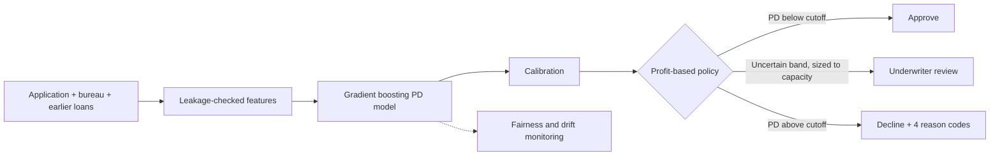

# Credit risk decision system

[](https://github.com/MohaamadAkbari/credit-risk/actions/workflows/ci.yml)

Decide, for every consumer-loan application, whether to **approve, send to an underwriter or decline**, so that
expected profit is as high as possible, every decline comes with reasons, and approval rates stay fair across
gender and age. Built on the [Home Credit Default Risk](https://www.kaggle.com/c/home-credit-default-risk) data:
307,511 applications with credit-bureau records and earlier loans, 58 million rows in eight tables.

> **Status:** Phases 0–2 complete (problem, formulation, data). Next: the tested feature pipeline (Phase 3) and
> baselines (Phase 4). No model is trained yet; the numbers below come from the data analysis and a rough check.

## The problem

A lender wants to approve more applicants with little or no credit history without raising losses. Declining a good
applicant loses the margin; approving a bad one loses part of the principal. One default costs about as much as the
margin on five good loans (12% margin and 60% loss given default, stated assumptions), so the cutoff has to come
from the economics, not from a 0.5 threshold.

| | |
| --- | --- |
| **Decision** | Approve, manual review or decline, per application |
| **Primary metric** | Expected profit per 1,000 applications ([ADR 0001](docs/decisions/0001-primary-metric.md)) |
| **Target** | At least +10% profit over approving everyone; scorecard comparison reported with a confidence interval |
| **Guardrails** | Default rate among approved loans ≤ 6.5%; approval-rate ratio ≥ 0.8 by gender and age band; p99 latency < 1 s; four reason codes per decline |
| **Out of scope** | Pricing, credit limits, collections, a full solution to reject inference |

Details: [problem brief](docs/01_problem_brief.md) · [ML formulation](docs/02_ml_formulation.md) ·
[decision log](docs/decision_log.md).

## Approach



1. **Predict** the probability of payment difficulty with only what is known on the application date.
2. **Calibrate** it, because the cutoff is a probability (break-even about 16.7% with the stated economics).
3. **Decide** with a three-way policy: the review band sits around the break-even risk and is sized by experiment to reviewer capacity.
4. **Explain** each decline with SHAP reason codes; **audit** approval rates by gender and age band, which are excluded from the inputs.

## Findings so far

From [the EDA](reports/eda_summary.md) and a [preliminary profit check](reports/preliminary_check.md):

- **8.07%** of applicants have payment difficulty. Thin-file applicants (no bureau record, 14.3%) are riskier: **10.1% vs 7.7%**.
- **No leakage found:** every event date is on or before the application; the only later dates are contracted end dates and 17 bureau rows, which are dropped ([leakage table](reports/leakage_table.md)).
- **Gender and age can be reconstructed from other columns** (ROC-AUC 0.89 and R² 0.72), so excluding them is not enough; fairness is judged on outcomes.
- A quick untuned model already beats approving everyone by about **+11%** in profit, but a better model beats a scorecard-like baseline by only **+1.9%**. That is why the target is set against approving everyone.

## Repository layout

```text
├── configs/
│   ├── economics.yaml             margin, LGD, review cost, guardrails (every profit number reads this)
│   └── feature_availability.csv   leakage verdict for all 218 columns (generated)
├── data/README.md                 data card; the data itself is not committed
├── docs/
│   ├── 01_problem_brief.md
│   ├── 02_ml_formulation.md
│   ├── decision_log.md            D01–D41
│   └── decisions/                 architecture decision records
├── notebooks/01_eda.ipynb         exploratory analysis (executed)
├── reports/                       EDA summary, leakage table, preliminary check, figures
├── scripts/preliminary_check.py   exploration, not part of the pipeline
├── src/credit_risk/               the package
│   └── data/                      interim conversion, feature-availability table
├── tests/                         unit tests (run without the data)
└── monitoring/                    (Phase 9)
```

## Getting started

Requires Python 3.10+ and a Kaggle account that has accepted the
[competition rules](https://www.kaggle.com/c/home-credit-default-risk/rules).

```bash
make install       # pip install -e ".[dev]"
make data          # download and unzip into data/home-credit-default-risk/ (needs Kaggle API credentials)
make interim       # raw CSV -> Parquet in data/interim/ (about 1 minute)
make phase2        # rebuild the leakage table and re-execute the EDA notebook
make test lint     # unit tests and static checks (no data needed)
```

`make help` lists every target. The pipeline was tested on a 4-core machine with 4 GB of memory.

## Roadmap

| Phase | Status | Output |
| --- | --- | --- |
| 0 Problem | ✅ | [Problem brief](docs/01_problem_brief.md) |
| 1 Formulation | ✅ | [ML formulation](docs/02_ml_formulation.md), [ADR 0001](docs/decisions/0001-primary-metric.md), [ADR 0002](docs/decisions/0002-economic-assumptions.md) |
| 2 Data | ✅ | [Data card](data/README.md), [EDA](notebooks/01_eda.ipynb), [leakage table](reports/leakage_table.md) |
| 3 Pipeline | ⏳ next | Tested cleaning and aggregation of the related tables |
| 4 Baselines | | Approve everyone, logistic scorecard |
| 5 Models | | LightGBM with tuning, monotonic variant, table ablation (main → bureau → all) |
| 6 Evaluation | | Calibration, slices, fairness, profit with confidence intervals, model card |
| 7 Decision policy | | Profit curve, review band, reason codes; experiments E1–E5 |
| 8 Deployment | | FastAPI `/score`, Docker, one AWS deployment |
| 9 Monitoring | | PSI drift, approval-rate and fairness alerts, runbook |
| 10 Iteration | | Challenger model, reject-inference discussion, model-risk pack |

## Limitations

- The label means payment difficulty on early instalments, not write-off, so profit is an estimate.
- Only granted loans have outcomes; applicants the lender rejected in the past are missing (reject inference).
- The economic values are placeholders with ranges, tested by sensitivity experiments ([ADR 0002](docs/decisions/0002-economic-assumptions.md)).
- There are no calendar dates, so the split is random and ageing over time cannot be measured directly.

## Data and licence

The data belongs to Home Credit and is used under the Kaggle competition rules. It is not redistributed here;
see the [data card](data/README.md) for provenance and a checksum.
