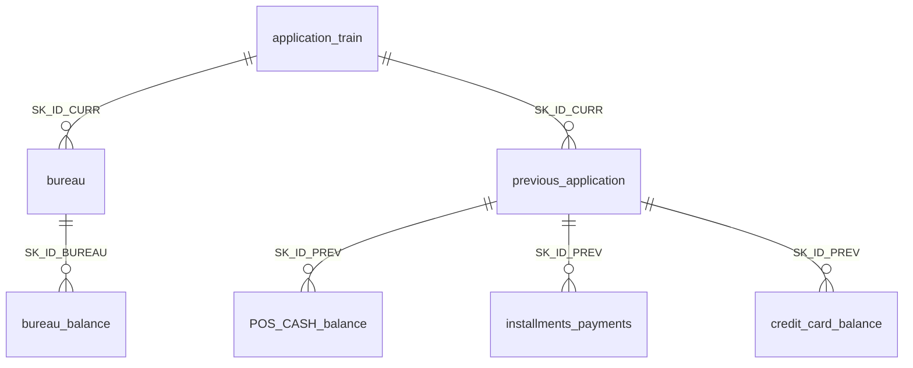

# Data card — Home Credit Default Risk

*Phase 2 artifact, 18 November 2026. Every number here comes from `notebooks/01_eda.ipynb` (executed) or
`credit_risk.data.availability`. Findings and their consequences: `reports/eda_summary.md`. Column-by-column leakage verdicts:
`reports/leakage_table.md`.*

## At a glance

| Item | Value |
| --- | --- |
| What it is | Consumer-loan applications to Home Credit, with the applicants' credit-bureau records and earlier Home Credit loans |
| Unit | One loan application (`SK_ID_CURR`). A few people have two: 588 groups of 2 applications share gender and three dates; the split keeps each person in one fold (D49) |
| Labelled applications | 307,511 in `application_train`, 122 columns |
| Label | `TARGET = 1`: payment difficulty (a late payment of more than X days on at least one of the first Y instalments; X and Y are not published). Not a write-off |
| Label rate | 8.07% (24,825 applicants) |
| Size | 8 tables, 58,489,893 rows, 2.7 GB of CSV |
| Dates | None. Every time field is days or months *relative to the application date* |
| Currency | Not stated. All money values are in one unnamed currency (bureau credits use four recoded currencies, 99.9% "currency 1") |
| Personal data | No names, addresses or document numbers; IDs are recoded. Contains sensitive attributes: gender, age, family status, children |

## Source, licence and version

- **Source:** [Home Credit Default Risk, Kaggle competition](https://www.kaggle.com/c/home-credit-default-risk) (2018). Files dated 11 December 2019 inside the archive.
- **Licence / terms:** governed by the competition rules, which the account holder accepted before downloading (D27). The data is **not redistributed**: it is excluded from git by `.gitignore`, and anyone reproducing the project must download it themselves.
- **Downloaded:** 17 November 2026 by the project owner.
- **Archive:** `data/home-credit-default-risk.zip`, 721,616,255 bytes,
  SHA-256 `4e7a243b13f6e3d40f682a9a0cfd59c70910ca6c5a4289f71ca1f25efbd8e3de`. If your hash differs, the numbers in this project may not match.

## How to reproduce

```bash
# 1. Accept the competition rules on Kaggle, then:
kaggle competitions download -c home-credit-default-risk -p data/
unzip data/home-credit-default-risk.zip -d data/home-credit-default-risk/
#    (or simply: make data)
# 2. Install the package, then rebuild everything behind the Phase 2 reports
make install
make interim     # raw CSV -> compact Parquet in data/interim (about 1 minute, 513 MB)
make leakage     # configs/feature_availability.csv and reports/leakage_table.md
make eda         # re-executes notebooks/01_eda.ipynb
```

Tested with Python 3.10, pandas 2.3, scikit-learn 1.7, pyarrow 25, matplotlib 3.10 on a 4-core machine with 4 GB of
memory. The large tables are read column by column; loading all eight at once in pandas does not fit in 4 GB.
Dependencies are declared in `pyproject.toml`.

## Folder layout

| Folder | Content | Rule |
| --- | --- | --- |
| `data/home-credit-default-risk/` | The 10 original CSVs | Raw, **never edited** |
| `data/interim/` | One Parquet file per table, made by `make interim`; IDs int32, other numbers float32, text as strings | Derived, rebuildable, not cleaned. float32 keeps about 7 significant digits: fine for exploration; Phase 3 features read the raw values |
| `data/processed/` | `split.parquet`, `features_{A,B,C}.parquet`, `audit.parquet` (made by `make split features`) | Derived, rebuildable; the split is locked by `configs/split_manifest.json` |

## Tables and how they join



| Table | Rows | Cols | One row is | Train applicants with ≥1 row | Join quality |
| --- | --- | --- | --- | --- | --- |
| `application_train` | 307,511 | 122 | an application, with `TARGET` | — | no duplicate IDs |
| `application_test` | 48,744 | 121 | an application, no label (Kaggle's test) | — | no overlap with train |
| `bureau` | 1,716,428 | 17 | a credit at another lender, as reported to the bureau | 85.7% | 14.6% of rows belong to Kaggle test applicants |
| `bureau_balance` | 27,299,925 | 3 | a month of a bureau credit | via bureau | 11.4% of rows have no parent in `bureau`; only 45.1% of bureau credits have monthly history |
| `previous_application` | 1,670,214 | 37 | an earlier application to Home Credit (approved, refused, cancelled or unused) | 94.6% | — |
| `POS_CASH_balance` | 10,001,358 | 8 | a month of an earlier POS or cash loan | 94.1% | 3.4% of rows: loan not in `previous_application` |
| `installments_payments` | 13,605,401 | 8 | an instalment (due and paid) of an earlier loan | 94.8% | 9.2% of rows: loan not in `previous_application`; split payments repeat the instalment key |
| `credit_card_balance` | 3,840,312 | 23 | a month of an earlier credit card | 28.3% | 28.2% of rows: card not in `previous_application` |

Where a child row's loan is missing from its parent table, its `SK_ID_CURR` still identifies the applicant, and no
row maps to a different applicant than its parent, so the rows can be aggregated to the applicant directly.

## Time coverage

There are no calendar dates, so we cannot say which years the data covers or test how a model ages. History reaches
back up to 96 months in the monthly tables and 2,922 days (8 years) for earlier applications and bureau credits.
Every past event is on or before the application date; the only positive dates are planned end dates of running
credits and 17 bureau update records (dropped). Details: `reports/leakage_table.md`.

The application ID does not hide a time order either: across ID deciles the default rate (7.9–8.3%), the mean of
`EXT_SOURCE_3` and the share of revolving loans are flat. A random split is the only option (D20).

## Population and known biases

| Bias | Evidence | Consequence |
| --- | --- | --- |
| **Only granted loans have labels** | Every row has a repayment outcome; earlier applications show Home Credit refuses 17.4% | The model never sees people the lender turned down (reject inference, documented as a limit) |
| Thin-file applicants are riskier, and lack the strongest score | 14.3% have no bureau record; they default at 10.1% vs 7.7%. `EXT_SOURCE_3` is missing for 96.9% of them (6.9% of others), bureau-enquiry counts for 94.3%; they skew young (7.7% under 25 vs 3.4%) | Reported as a separate slice, together with age (D30, D56); bureau-derived columns at stage B (D50) |
| Gender imbalance | 65.8% women; default 7.0% (women) vs 10.1% (men); 4 rows "XNA" | Fairness audit on outcomes (D15) |
| Age gradient | Default falls from 12.3% (under 25) to 3.7% (65+) | Fairness audit by age band |
| Product mix and loan terms | 90.5% cash loans; revolving loans 9.5% train but 0.9% in Kaggle's test, whose loans are also shorter (median 16.3 vs 20.0 months); a model tells the two files apart with ROC-AUC 0.887 | Kaggle test is not our test set (D20); usable as a strongly shifted population for drift tests (D41) |
| Loan size | Default is hump-shaped in the amount (6.1% for the largest fifth, 10.1% in the middle); 7.52% weighted by amount | Profit weighted by amount (D54, ADR 0003) |
| Pensioners coded as a placeholder | 55,374 rows have `DAYS_EMPLOYED = 365243`; all pensioners or unemployed; `FLAG_EMP_PHONE = 0` marks the same rows | Recode plus flag; it is a strong age proxy |

## Sensitive attributes and proxies

`CODE_GENDER` and `DAYS_BIRTH` are excluded from the model inputs and kept for the fairness audit (D23). The other
columns, however, recover them: a model predicts gender with ROC-AUC 0.89 and age with R² 0.72 (about 5 years mean
error) from the remaining main-table columns. The strongest proxies are occupation, organisation type and car
ownership (gender), and `FLAG_EMP_PHONE`, `FLAG_DOCUMENT_6`, number of children and `EXT_SOURCE_1` (age). `FLAG_EMP_PHONE`
is in effect pension status (it equals the pensioner marker in all but 12 rows), so the main age proxy is income type.
Excluding the attributes therefore does not make the model blind to them; fairness must be checked on outcomes.

Other attributes that some jurisdictions treat as sensitive are present and used as inputs: family status, number of
children, housing type, region rating. They are flagged for the governance pack in Phase 10.

## Data quality summary

- 67 of 122 main-table columns have missing values; 49 are more than 40% missing. The 47 building-statistics columns are missing together for 47.4% of applicants, and missingness carries signal (9.3% vs 7.0% default).
- Placeholders: 365243 ("no date") in `DAYS_EMPLOYED` and five `previous_application` date columns; `XNA` and `XAP` codes in several categorical columns; `-1` in `SELLERPLACE_AREA`; 0 in `AMT_CREDIT` for refused earlier applications; 64 and 65 in `OWN_CAR_AGE` (3,334 rows); 0 in `DAYS_LAST_PHONE_CHANGE` (37,672 rows). `EXT_SOURCE_2` values near 0 were checked and are real (D55).
- Errors and outliers: one income of 117,000,000; 134 bureau end dates about 110 years in the past; 20 bureau credits that end before they start; 392 instalments paid more than a year early.
- Near-constant columns: `FLAG_MOBIL` and six document flags differ in fewer than 100 rows.
- Near-duplicates: `OBS_30` / `OBS_60_CNT_SOCIAL_CIRCLE` (r = 0.998), `AMT_CREDIT` / `AMT_GOODS_PRICE` (0.987), the two region ratings (0.951), `FLAG_EMP_PHONE` / the employment marker.
- Process fields: application hour and weekday, excluded from inputs (D51).

Full list with counts: `notebooks/01_eda.ipynb`, sections 4 and 10. Handling rules: `reports/leakage_table.md`.

## Intended use

For this portfolio project only: training and evaluating a credit decision policy under the competition terms.
Not for real lending decisions; the label is a proxy for loss, the economics are placeholders, and the population is
one lender's granted loans in an unknown period.
