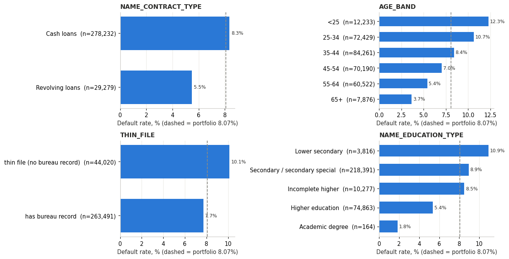

# Exploratory data analysis: summary (Phase 2)

*18 November 2026. Source of every number: `notebooks/01_eda.ipynb` (executed). Data description: `data/README.md`.
Column-by-column leakage verdicts: `reports/leakage_table.md`. Figures: `reports/figures/`.*

## The short version

The data is usable and clean enough for the project, and nothing in it leaks the outcome. Five findings change what we build next:

1. **Thin-file applicants, the group the business wants to grow, are 25% riskier than the rest** (10.1% vs 7.7% default). Their slice will be reported on its own.
2. **Gender and age can be reconstructed from the other columns** (gender ROC-AUC 0.89, age R² 0.72). Leaving them out of the inputs does not make the model blind, so fairness must be measured on outcomes. This bears on open question D15.
3. **Missing data carries information.** Missing external scores and missing building data go with higher risk; a missing occupation goes with lower risk (pensioners). Phase 3 keeps missingness as a feature instead of filling it blindly.
4. **Only 17 rows in 58 million are dated after the application** (bureau update records). They are dropped. Two columns have legitimately positive dates (planned end dates).
5. **The external scores dominate; the related tables add behaviour.** Prior refusals, late instalments and current overdue credits each roughly double the default rate at their worst. This supports the main → bureau → all-tables ablation (D25).

## 1. Tables and joins

Eight tables, 58.5 million rows. The main table has one row per application (307,511 labelled), with no duplicate IDs
and no overlap with Kaggle's unlabelled test file. 85.7% of applicants have a bureau record, 94.6% have earlier Home
Credit applications, but only 28.3% have an earlier credit card. Some child rows refer to loans missing from their
parent table (up to 28% for credit cards, 11% for bureau months); they still carry the applicant ID and are kept,
except monthly bureau rows with no parent credit, which cannot be joined.

## 2. Who defaults

| Segment | Default rate | Note |
| --- | --- | --- |
| Portfolio | 8.07% | 24,825 of 307,511 |
| Men / women | 10.1% / 7.0% | 34% / 66% of applicants |
| Under 25 / 65 and over | 12.3% / 3.7% | Steady decline with age |
| Thin file / has bureau record | 10.1% / 7.7% | 14.3% thin file |
| Cash / revolving loans | 8.3% / 5.5% | Revolving is 9.5% of rows, so per-product results for it will be noisy |
| Lower secondary / higher education | 10.9% / 5.4% | |
| Low-skill labourers / accountants | 17.2% / 4.8% | Highest and lowest sizeable occupations |

**For the decision:** with the placeholder economics, approving pays below a risk of 16.7%. Only one sizeable
segment (low-skill labourers, 2,093 applicants, 17.2%) sits near that line, so the profit comes from separating
individuals, not from excluding groups. Rare categories with extreme rates (5 applicants on maternity leave, 22
unemployed) are noise and will be grouped.

## 3. Missing data

67 of 122 main-table columns have gaps; 49 are more than 40% empty. The 47 building-statistics columns
(`_AVG`, `_MODE`, `_MEDI`) are missing together for 47.4% of applicants.

| Column | Missing | Default if missing | Default if present |
| --- | --- | --- | --- |
| `EXT_SOURCE_1` | 56.4% | 8.5% | 7.5% |
| `EXT_SOURCE_3` | 19.8% | 9.3% | 7.8% |
| Building statistics | 47–70% | 9.2% | 7.0% |
| `OCCUPATION_TYPE` | 31.3% | 6.5% | 8.8% |
| `AMT_REQ_CREDIT_BUREAU_*` | 13.5% | 10.3% | 7.7% |

**Rule for Phase 3:** add missing-indicator flags for these columns and a "missing" level for categories. `OWN_CAR_AGE`
is missing for every applicant without a car, so `FLAG_OWN_CAR` already covers it.

## 4. Placeholders and errors

| Issue | Size | Handling |
| --- | --- | --- |
| `DAYS_EMPLOYED = 365243` | 55,374 rows (18%), all pensioners or unemployed; default 5.4% | Missing + flag; same rows as `ORGANIZATION_TYPE = 'XNA'` |
| 365243 in five `previous_application` date columns | 40,645 to 934,444 rows per column | Missing + flag |
| Income of 117,000,000 | 1 row (250 above 1,000,000) | Cap at the training 99.9th percentile |
| Bureau dates about 110 years ago | 134 end dates, 95 update dates | Missing |
| Bureau credits that end before they start | 20 | Missing end date |
| Split instalment payments | 653,483 repeated (loan, version, number) keys | Sum per instalment before computing lateness |
| Earlier applications with `AMT_CREDIT = 0` | 336,768 (refused, cancelled, unused) | Use amounts of approved applications only |
| Near-constant flags | `FLAG_MOBIL` and six document flags (<100 rows differ) | Drop for lack of signal |

## 5. Strongest signals (preview, not a model)

Each external score alone ranks applicants with ROC-AUC 0.66–0.68. Their lowest decile defaults at 18–20%, their
highest at about 3%. The related tables add behaviour the main table lacks:

| Signal | Worst group | Default rate |
| --- | --- | --- |
| Any bureau credit overdue at application | 3,397 applicants | 15.9% (vs 7.6%) |
| More than half of earlier applications refused | 11,158 | 15.9% (vs 7.1% with none) |
| More than 20% of earlier instalments paid late | 37,462 | 12.0% (vs 6.8% never late) |
| A bureau credit opened in the 7 days before applying | 629 | 19.7% |

## 6. Leakage

Every date in the data is relative to the application, so a positive value would mean "after the decision". Checked
for all 20 date columns in all seven training tables:

- **Event dates** (payments, decisions, monthly snapshots, credit openings) are all on or before the application.
- **Planned end dates** are positive by nature and known at application: `bureau.DAYS_CREDIT_ENDDATE` (602,603 rows, 80% on active credits) and `previous_application.DAYS_LAST_DUE_1ST_VERSION` (224,392 rows, all approved loans). Allowed.
- **17 bureau rows** were last updated 10 to 372 days after the application. Dropped.
- `bureau_balance` month 0 is the application month itself. Allowed, with a month ≤ −1 ablation.
- **Seven columns have undocumented timing:** the three external scores and the four social-circle default counts. Kept, on the assumption that they are bought at application; flagged `review`.

All 218 columns, with the verdict and rule for each, are in `reports/leakage_table.md` and
`configs/feature_availability.csv` (which Phase 3 tests will read).

## 7. Proxies for gender and age

A gradient-boosting model trained on all other main-table columns (80,000 applicants, 3-fold cross-validation):

| Attribute | How well the other columns recover it | Strongest proxies |
| --- | --- | --- |
| Gender | ROC-AUC 0.892 (0.5 = no information) | Occupation (0.78 alone), organisation type (0.70), car ownership (0.67), income (0.63) |
| Age | R² 0.720; mean error 4.7 years vs 10.2 by guessing | `FLAG_EMP_PHONE` (r = 0.62; pensioners give no work phone), `FLAG_DOCUMENT_6` (0.41), `EXT_SOURCE_1` (0.60 where present), number of children (0.33) |

**What this means.** Excluding gender and age is still right, but it is not enough to call the model neutral. The
preliminary run already showed approval ratios of 0.95 (gender), so there is no alarm yet. In Phase 6 we will measure
the gaps on the real model and test whether removing or constraining the strongest proxies (above all `EXT_SOURCE_1`)
narrows them, and at what profit cost.

## 8. Kaggle's test file

It has almost no revolving loans (0.9% vs 9.5%) and no labels. It cannot serve as our test set (we lock 15% of
`application_train`, D20), but it is a ready-made shifted population for the drift simulation in Phase 9.

## What Phase 3 inherits

1. Drop the 17 post-application bureau rows; recode 365243 and the other markers; cap the outliers listed in section 4.
2. Missing-indicator flags for the informative gaps; "missing" as a category level.
3. Aggregations: bureau (counts, overdue, debt, recent openings), earlier applications (refusal share, amounts of approved ones), instalments (lateness after summing split payments), monthly tables (worst days past due, recent trend).
4. A test that fails if any feature uses a column marked `key`, `label` or `protected` in `configs/feature_availability.csv`.
5. Thin-file and proxy columns tagged so evaluation can slice by them.

## Limits of this analysis

Single descriptive cuts, no confidence intervals, and no model beyond the proxy test. Default rates by segment are
not causal. Money columns were read as float32 (7 significant digits) in `data/interim/`; that does not change any
rate or count above.
