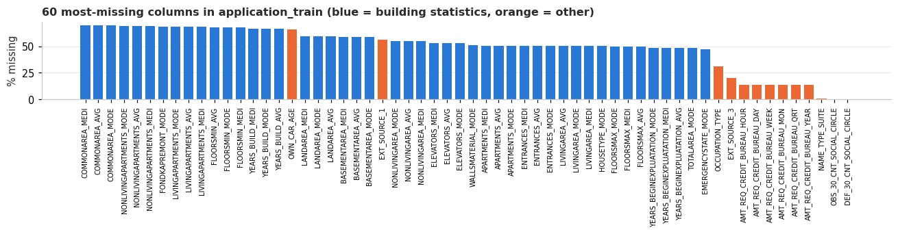
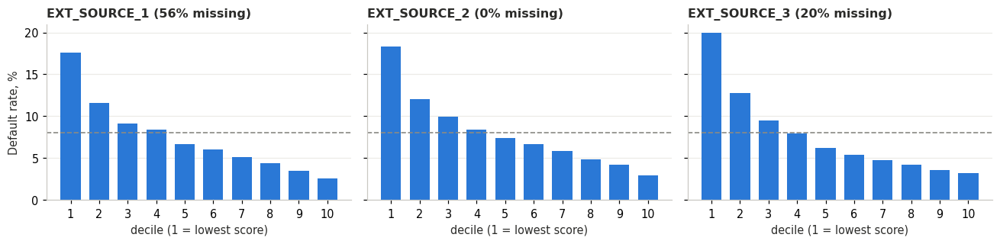

# P01 — Exploratory data analysis: summary (Phase 2)

*18 November 2026, revised 19 November after the manager review (`docs/04_manager_review_phase2.md`). Source of every
number: `notebooks/01_eda.ipynb` (executed; section 10 runs `scripts/phase2_review_checks.py`). Data description:
`data/README.md`. Column-by-column leakage verdicts: `reports/leakage_table.md`. Figures: `reports/figures/`.*

## The short version

The data is usable and clean enough for the project, and nothing in it leaks the outcome. Seven findings change what we build next:

1. **Thin-file applicants, the group the business wants to grow, are 25% riskier than the rest** (10.1% vs 7.7% default),
   **and they lack the strongest signal:** `EXT_SOURCE_3` is missing for 96.9% of them. Their slice will be reported on its own.
2. **Gender and age can be reconstructed from the other columns** (gender ROC-AUC 0.89, age R² 0.72). Leaving them out of the inputs does not make the model blind, so fairness must be measured on outcomes. This bears on open question D15.
3. **Missing data carries information, but much of it is one fact: no bureau record.** Missing `EXT_SOURCE_3` and missing bureau-enquiry counts are almost exactly the thin-file group, so those columns move to stage B (D50). Missing building data still goes with higher risk and a missing occupation with lower risk (pensioners).
4. **Only 17 rows in 58 million are dated after the application** (bureau update records). They are dropped. Two columns have legitimately positive dates (planned end dates).
5. **The external scores dominate; the related tables add behaviour.** Prior refusals, late instalments and current overdue credits each roughly double the default rate at their worst. This supports the main → bureau → all-tables ablation (D25).
6. **Risk depends on loan size and length, and not in a straight line.** Default peaks at 10.1% for mid-sized loans and falls to 6.1% for the largest; weighted by money lent it is 7.52%, not 8.07%. Profit is therefore weighted by loan amount (ADR 0003).
7. **Kaggle's test file is a strong shift, not a mild one** (a model tells it apart with ROC-AUC 0.887): shorter loans and bureau enquiries recorded differently, as well as fewer revolving loans.

## 1. Tables and joins

Eight tables, 58.5 million rows. The main table has one row per application (307,511 labelled), with no duplicate IDs
and no overlap with Kaggle's unlabelled test file. 85.7% of applicants have a bureau record, 94.6% have earlier Home
Credit applications, but only 28.3% have an earlier credit card. Some child rows refer to loans missing from their
parent table (up to 28% for credit cards, 11% for bureau months); they still carry the applicant ID and are kept,
except monthly bureau rows with no parent credit, which cannot be joined.

**An ID is an application, not a person.** 588 groups of applications (1,176 rows) share gender, birth date,
ID-document date and registration date, almost certainly the same person applying twice; 24 groups have different
outcomes. The split now keeps each person in one fold (D49).

## 2. Who defaults

| Segment | Default rate | Note |
| --- | --- | --- |
| Portfolio | 8.07% | 24,825 of 307,511; **7.52% weighted by loan amount** |
| Men / women | 10.1% / 7.0% | 34% / 66% of applicants |
| Under 25 / 65 and over | 12.3% / 3.7% | Steady decline with age |
| Thin file / has bureau record | 10.1% / 7.7% | 14.3% thin file |
| Cash / revolving loans | 8.3% / 5.5% | Revolving is 9.5% of rows, so per-product results for it will be noisy |
| Lower secondary / higher education | 10.9% / 5.4% | |
| Low-skill labourers / accountants | 17.2% / 4.8% | Highest and lowest sizeable occupations |

**By loan size and length** (fifths of applicants; added 19 Nov):

| Loan amount | Default | Loan term (credit ÷ annuity, months) | Default |
| --- | --- | --- | --- |
| up to 255k | 7.2% | 8–15 | 8.1% |
| 255k–432k | 9.2% | 15–20 | 9.9% |
| 432k–604k | 10.1% | 20–22 | 9.7% |
| 604k–900k | 7.9% | 22–30 | 6.2% |
| above 900k | 6.1% | 30–45 | 6.5% |

Borrowing more than the goods price is one of the clearest main-table signals: 4.7% default when credit is 1.00–1.08
times the price, rising to 11.5% above 1.21 times (financed extras). Annuity-to-income matters little (7.2% to 8.5%).
The lower rate of long loans may partly come from the label, which counts difficulty only in the first instalments.

**For the decision:** with the placeholder economics, approving pays below a risk of 16.7%. Only one sizeable
segment (low-skill labourers, 2,093 applicants, 17.2%) sits near that line, so the profit comes from separating
individuals, not from excluding groups. Rare categories with extreme rates (5 applicants on maternity leave, 22
unemployed) are noise and will be grouped. Because large loans are safer, profit is counted per unit of principal,
not per loan (ADR 0003); the flat 12% margin fits a median loan but not a 10- or 34-month one (experiment E6).

## 3. Missing data

67 of 122 main-table columns have gaps; 49 are more than 40% empty. The 47 building-statistics columns
(`_AVG`, `_MODE`, `_MEDI`) are missing together for 47.4% of applicants.

| Column | Missing | Default if missing | Default if present |
| --- | --- | --- | --- |
| `EXT_SOURCE_1` | 56.4% | 8.5% | 7.5% |
| `EXT_SOURCE_3` | 19.8% | 9.3% | 7.8% |
| Building statistics | 47–70% | 9.2% | 7.0% |
| `OCCUPATION_TYPE` | 31.3% | 6.5% | 8.8% |
| `AMT_REQ_CREDIT_BUREAU_*` | 13.5% | 10.3% | 7.7% |

**Two of these are the thin-file flag in disguise** (added 19 Nov):

| | Has bureau record | Thin file |
| --- | --- | --- |
| `EXT_SOURCE_3` missing | 6.9% | 96.9% |
| `AMT_REQ_CREDIT_BUREAU_*` missing | 0.0% | 94.3% |
| `EXT_SOURCE_1` missing | 55.6% | 60.8% |
| Ranking power of the mean external score (ROC-AUC) | 0.724 | 0.683 |

So these columns are bureau information and enter the model at stage B (D50). The model will rank thin-file
applicants less well; `EXT_SOURCE_2`, present for nearly all of them, still ranks them (0.672). A decline reason
built from these missing flags means "no credit history" and is handled as one reason (D53).

**Rule for Phase 3:** add missing-indicator flags for these columns and a "missing" level for categories. `OWN_CAR_AGE`
is missing for every applicant without a car, so `FLAG_OWN_CAR` already covers it.

## 4. Placeholders and errors

| Issue | Size | Handling |
| --- | --- | --- |
| `DAYS_EMPLOYED = 365243` | 55,374 rows (18%), all pensioners or unemployed; default 5.4% | Missing + flag; same rows as `ORGANIZATION_TYPE = 'XNA'` and as `FLAG_EMP_PHONE = 0` (all but 12 rows) |
| 365243 in five `previous_application` date columns | 40,645 to 934,444 rows per column | Missing + flag |
| `OWN_CAR_AGE` = 64 or 65 *(19 Nov)* | 2,443 + 891 car owners, against 1–2 rows at 63 and 69 | Code, not an age: missing + flag |
| `DAYS_LAST_PHONE_CHANGE` = 0 *(19 Nov)* | 37,672 rows (12.3%) against 2,812 at −1; default 9.7% | Process value: missing + flag |
| `EXT_SOURCE_2` below 0.001 *(19 Nov)* | 202 rows, continuous tail, default 43.6% | Real low scores: kept |
| Income of 117,000,000 | 1 row (250 above 1,000,000) | Cap at the training 99.9th percentile |
| Bureau dates about 110 years ago | 134 end dates, 95 update dates | Missing |
| Bureau credits that end before they start | 20 | Missing end date |
| Split instalment payments | 653,483 repeated (loan, version, number) keys | Sum per instalment before computing lateness |
| Earlier applications with `AMT_CREDIT = 0` | 336,768 (refused, cancelled, unused) | Use amounts of approved applications only |
| Near-constant flags | `FLAG_MOBIL` and six document flags (<100 rows differ) | Drop for lack of signal |
| Near-duplicate columns *(19 Nov)* | `OBS_30` / `OBS_60` social circle (r = 0.998); `FLAG_EMP_PHONE` / employment marker | Drop one of each (D52); other close pairs grouped for reason codes |

**Application hour** *(19 Nov)*: default runs from 10–11% at 5–7 am to 6.5% at 5 pm, but most of that is region and
time zone (22% of applications in the riskiest region rating start by 7 am, against 0.6% in the safest). Hour and
weekday describe the process, not the applicant, and are excluded from the inputs (D51).

## 5. Strongest signals (preview, not a model)

Each external score alone ranks applicants with ROC-AUC 0.66–0.68. Their lowest decile defaults at 18–20%, their
highest at about 3%. The related tables add behaviour the main table lacks:

| Signal | Worst group | Default rate |
| --- | --- | --- |
| Any bureau credit overdue at application | 3,397 applicants | 15.9% (vs 7.6%) |
| More than half of earlier applications refused | 11,158 | 15.9% (vs 7.1% with none) |
| More than 20% of earlier instalments paid late | 37,462 | 12.0% (vs 6.8% never late) |
| A bureau credit opened in the 7 days before applying | 629 | 19.7% |

Whether each feature's risk rises, falls or peaks, measured on the training fold only, is in
`reports/feature_shapes.md` (Phase 3). It decides scorecard bins and monotone constraints.

## 6. Leakage

Every date in the data is relative to the application, so a positive value would mean "after the decision". Checked
for all 20 date columns in all seven training tables:

- **Event dates** (payments, decisions, monthly snapshots, credit openings) are all on or before the application.
- **Planned end dates** are positive by nature and known at application: `bureau.DAYS_CREDIT_ENDDATE` (602,603 rows, 80% on active credits) and `previous_application.DAYS_LAST_DUE_1ST_VERSION` (224,392 rows, all approved loans). Allowed.
- **17 bureau rows** were last updated 10 to 372 days after the application. Dropped.
- `bureau_balance` month 0 is the application month itself. Allowed, with a month ≤ −1 ablation.
- **Seven columns have undocumented timing:** the three external scores and the four social-circle default counts. Kept, on the assumption that they are bought at application; flagged `review`.
- **No earlier application is the current loan in disguise** *(19 Nov)*. 648 applicants have an earlier application with exactly the same amount and annuity, 465 of them refused (re-applications). 1,415 had an approval in the 7 days before; their default rate, 8.3%, is the portfolio rate.
- **The application ID is not a hidden time order** *(19 Nov)*: default (7.9–8.3%), mean `EXT_SOURCE_3` and the revolving share are flat across ID deciles. A random split remains the only option (D20).

All 218 columns, with the verdict and rule for each, are in `reports/leakage_table.md` and
`configs/feature_availability.csv` (which Phase 3 tests read).

## 7. Proxies for gender and age

A gradient-boosting model trained on all other main-table columns (80,000 applicants, 3-fold cross-validation):

| Attribute | How well the other columns recover it | Strongest proxies |
| --- | --- | --- |
| Gender | ROC-AUC 0.892 (0.5 = no information) | Occupation (0.78 alone), organisation type (0.70), car ownership (0.67), income (0.63) |
| Age | R² 0.720; mean error 4.7 years vs 10.2 by guessing | `FLAG_EMP_PHONE` (r = 0.62), `FLAG_DOCUMENT_6` (0.41), `EXT_SOURCE_1` (0.60 where present), number of children (0.33) |

`FLAG_EMP_PHONE` is not really a phone signal: it equals the pensioner / unemployed marker in all but 12 rows. The
strongest age proxy is therefore **pension status**, which is legitimate income information. It is dropped as a
duplicate (D52), and the employment marker that carries the same information remains.

**What this means.** Excluding gender and age is still right, but it is not enough to call the model neutral. The
preliminary run already showed approval ratios of 0.95 (gender), so there is no alarm yet. In Phase 6 we will measure
the gaps on the real model and test whether removing or constraining the strongest proxies (above all `EXT_SOURCE_1`
and income type) narrows them, and at what profit cost. Age bands are fixed now (D56): <25, 25–34, 35–44, 45–54, 55–64,
65+. Every gender × age cell is large enough to measure; the smallest is men aged 65 and over (1,504 applicants,
default 5.6% ± 1.2 points).

## 8. Kaggle's test file

It has no labels, so it cannot serve as our test set (we lock 15% of `application_train`, D20). It is a ready-made
shifted population for the drift simulation in Phase 9, and a stronger shift than first described. A model separates
it from the training file with ROC-AUC 0.887 *(19 Nov)*. What differs:

| | Training file | Kaggle test |
| --- | --- | --- |
| Revolving loans | 9.5% | 0.9% |
| Median loan term (credit ÷ annuity) | 20.0 months | 16.3 months |
| Loans under 12 months | 11.6% | 21.4% |
| Bureau enquiries in the last month, any | 14.2% | 0.7% |
| Bureau enquiries in the last quarter, any | 16.4% | 39.3% |

The amounts and annuities are the strongest separators. The enquiry counts look as if they were recorded in different
time buckets, so the short-window `AMT_REQ_CREDIT_BUREAU_*` columns are a drift risk to test in Phase 5 (ablation
without them) and to monitor in Phase 9.

## What Phase 3 inherits

1. Drop the 17 post-application bureau rows; recode 365243 and the other markers (including car age 64/65 and phone change day 0); cap the outliers listed in section 4.
2. Missing-indicator flags for the informative gaps; "missing" as a category level.
3. Aggregations: bureau (counts, overdue, debt, recent openings), earlier applications (refusal share, amounts of approved ones), instalments (lateness after summing split payments), monthly tables (worst days past due, recent trend).
4. A test that fails if any feature uses a column marked `key`, `label`, `protected` or `exclude` in `configs/feature_availability.csv`.
5. Thin-file and proxy columns tagged so evaluation can slice by them.
6. *(19 Nov)* Split by person (D49); bureau-derived main-table columns at stage B (D50); hour and weekday excluded (D51); duplicates dropped and reason-code groups (D52); profit weighted by amount (D54).

## Limits of this analysis

Single descriptive cuts and no model beyond the proxy and adversarial tests. The few intervals given (fairness cells)
are binomial; the headline comparisons are far outside chance (for example, the thin-file gap of 2.4 points rests on
44,020 applicants). Default rates by segment are not causal. Like the first pass, the 19 November checks describe all
labelled applications; only the feature-shape table, which drives modelling choices, is restricted to the training
fold. Money columns were read as float32 (7 significant digits) in `data/interim/`; that does not change any rate or count above.
