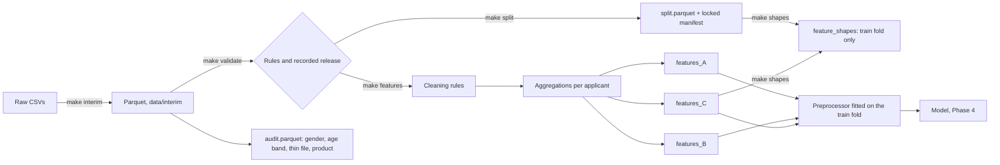

# Data pipeline and features (Phase 3)

*18 November 2026, revised 19 November after the Phase 2 manager review (`docs/04_manager_review_phase2.md`).
Code: `src/credit_risk/data/` and `src/credit_risk/features/`. Rebuild: `make phase3` (validate, split, features, shapes).
Machine-readable record: `configs/data_contract.json`, `configs/split_manifest.json`, `configs/feature_manifest.json`, `configs/feature_shapes.csv`,
`configs/reason_codes.yaml`.*

## Summary

The pipeline turns the eight raw tables into one row per applicant for each ablation stage (D25): **83 features for
stage A** (application form), **116 for B** (+ credit-bureau information) and **157 for C** (+ Home Credit history).
It applies every cleaning rule from the leakage table, reads only columns the leakage table allows, and runs in about
17 seconds (peak memory 3.3 GB). The train / validation / test split keeps each person in one fold, and it is fixed and
fingerprinted. Nothing is built until the data passes its checks (D60), and every feature table carries a content
fingerprint that later phases verify on reading (D61). 62 unit tests cover the rules; none needs the Kaggle data.

**What changed on 19 November.** The split is now by person, not by application (D49). Seven bureau-derived
main-table columns moved from stage A to B (D50), which is why A went from 93 to 83 features while B and C kept 116
and 157. Application hour and weekday are excluded (D51). Two duplicates were dropped and reason-code groups were added
(D52). Two more codes are recoded (D55). A training-fold feature-shape table was added (D57). Data checks and
feature fingerprints were added (D60, D61).

## How it fits together

| Step | Module | Output |
| --- | --- | --- |
| Data checks | `credit_risk.data.validate` | Pass or fail; `configs/data_contract.json` records the release |
| Cleaning | `credit_risk.data.clean` | Applied inside each feature module; nothing fitted |
| Split | `credit_risk.data.split` | `data/processed/split.parquet`, `configs/split_manifest.json` |
| Features | `credit_risk.features.*` | `data/processed/features_{A,B,C}.parquet`, fingerprints in `configs/feature_manifest.json` |
| Audit table | `credit_risk.features.audit` | `data/processed/audit.parquet` (never a model input) |
| Feature shapes | `credit_risk.features.shapes` | `reports/feature_shapes.md`, `configs/feature_shapes.csv` |
| Preprocessing | `credit_risk.features.preprocess` | An unfitted scikit-learn transformer, fitted on the train fold inside the model pipeline |

## The split (D20, D42, D49)

Stratified on `TARGET`, seed 42, rows sorted by applicant ID first so the split does not depend on file order.
**Whole persons go to one fold.** A person is a group of applications sharing gender, birth date, ID-document date
and registration date: 588 groups of two applications. Before the change, 289 of them sat in two folds. The key reads
two protected columns for grouping only; they never reach a feature table. Stratification uses each person's worst
outcome.

| Fold | Applicants | Defaults | Default rate |
| --- | --- | --- | --- |
| train | 215,251 | 17,374 | 8.07% |
| valid | 46,133 | 3,725 | 8.07% |
| test | 46,127 | 3,726 | 8.08% |

Each fold's sorted IDs are fingerprinted (SHA-256) in `configs/split_manifest.json`. Rebuilding the split refuses
to overwrite a different result unless run with `--relock` (`make split ARGS=--relock`). It was relocked once, on
19 November, before any model was trained; the old manifest is in git history.

## Cleaning rules applied

| Table | Rule |
| --- | --- |
| application | `DAYS_EMPLOYED = 365243` to missing plus flag `EMPLOYED_NA`; `OWN_CAR_AGE` 64/65 to missing plus `CAR_AGE_CODED`; `DAYS_LAST_PHONE_CHANGE = 0` to missing plus `PHONE_CHANGE_DAY0` (D55); gender `XNA` to missing (audit only); region ratings outside 1–3 to missing (none in training; one −1 in Kaggle's test, D60) |
| bureau | Drop the 17 rows updated after the application; dates below −40,000 days and end dates before the start to missing |
| bureau_balance | Months up to 0 (the application month); `--bb-max-month -1` builds the stricter ablation |
| previous_application | 365243 in five date columns and −1 in `SELLERPLACE_AREA` to missing; `AMT_CREDIT` only for approved applications; tiny negative down payments to 0 |
| installments | Split payments summed per instalment; lateness from the last payment; earliness capped at 365 days; unpaid instalments kept as missing payments |
| all amounts in bureau | Only "currency 1" (99.9% of rows) enters amount sums |

## Features by block

| Block | Stage | Features | Applicants with source rows | Examples |
| --- | --- | --- | --- | --- |
| application | A | 83 | 307,511 | form columns, plus credit/income, annuity/income, credit/goods, term, income per person, mean and min of external scores 1 and 2, document count, `EMPLOYED_NA`, the two new code flags |
| application_bureau | B | 10 | 307,511 | `EXT_SOURCE_3`, the six bureau-enquiry counts, and mean, min and count over all three external scores (D50) |
| bureau | B | 23 | 263,490 | credit counts (active, bad debt or sold, opened in last 7 / 90 days), current overdue, active debt and its ratio to credit, remaining term, worst days-past-due bucket ever and in the last 12 months, share of late months |
| previous | C | 17 | 291,057 | applications approved / refused / cancelled, refused share, days since last refusal, applications in last 30 days, asked vs granted, running loans and their annuity, reject reasons |
| installments | C | 8 | 291,643 | late share overall and in the last year, mean and max days late, unpaid count, under-paid share, paid ratio |
| pos | C | 6 | 289,444 | months, loans, worst days past due overall and in the last 12 months, remaining instalments on active loans |
| credit_card | C | 10 | 86,905 | utilisation mean and latest, drawings, worst days past due, share of months paid below the minimum, latest balance and limit |

From the main table, 41 columns allowed by the leakage table are left out of stage A on purpose: 7 near-constant
flags, 28 building-statistics duplicates (`_MEDI` correlates 0.99+ with `_AVG`, numeric `_MODE` 0.97+, with the same
missing pattern), 2 more duplicates (`FLAG_EMP_PHONE`, `OBS_60_CNT_SOCIAL_CIRCLE`, D52) and the 7 bureau-derived columns,
which enter at stage B instead. The application hour and weekday are not allowed at all (`exclude`, D51). When an
applicant has no rows in a related table, counts and sums are 0 (no credits) while ratios, means and maxima stay
missing (D44).

## Feature shapes (D57)

`make shapes` measures, on the **training fold only**, how default risk moves across deciles of each stage C
feature, plus its information value (`reports/feature_shapes.md`). Of 157 features: 17 fall steadily as the value
grows, 28 rise steadily, 13 are irregular and 1 is hump-shaped. 14 are categorical, and 84 have too little signal
(IV below 0.02) to have a shape. The steady ones get a monotone-constraint suggestion (+1 / −1) for Phase 5. The
irregular ones stay unconstrained and get non-monotone scorecard bins in Phase 4. They include loan amount, goods
price and credit term, whose rates zig-zag because amounts and terms cluster at round values.

## Data checks and fingerprints (D60, D61)

`make validate` runs before the split and the features, and they are not built if it fails. It reads one column at a
time (8 seconds for all 58.5 million rows, raw-file hashes included) and reports two kinds of failure:

| Kind | What it checks | What a failure means |
| --- | --- | --- |
| **Rules**, true of any release | Keys present and unique; label 0 or 1; flags 0/1 or Y/N; normalised scores in [0, 1]; ratings 1–3; hours 0–23; ages 18–100; counts and application amounts not negative; no past date after the application, except planned end dates and the 17 bureau rows the pipeline drops; columns match the leakage table; every related row points at a known applicant; no applicant in both Kaggle files | The data is wrong |
| **Profile** of the release this project was built on (`configs/data_contract.json`) | Row counts, columns, types, missing counts, minimum and maximum, category levels, and the size and SHA-256 of every raw CSV | The data is different (another download or a changed conversion), so every reported number may move |

On the current data both pass. The rules found one problem the EDA had missed: Kaggle's test file has a region
rating of −1 in one row. It is now recoded to missing (the training data has none, so no feature changed) and listed
as a known exception. `make data` checks the downloaded archive against the recorded SHA-256 before unzipping.

Each output table has a **content fingerprint** in `configs/feature_manifest.json`: a SHA-256 of its column names,
types, index and values, which does not depend on the Parquet writer. Two builds in a row give the same fingerprints.
`make verify` recomputes them, and Phase 4 onwards reads features through `credit_risk.features.build.load_stage`,
which refuses a table that differs from the manifest. A result can therefore be traced to the exact features, split
(`configs/split_manifest.json`) and data release behind it.

## Guards against leakage and unfairness

- **Declared sources.** Every feature module lists the exact columns it reads, and the loader reads nothing else.
  `tests/test_feature_sources.py` checks each one against `configs/feature_availability.csv`: no label, no protected
  or excluded attribute, keys only for joining, and no column used before its ablation stage (so `EXT_SOURCE_3` cannot
  slip back into stage A).
- **Protected attributes live in a separate audit table** with gender, age and age band, thin file and product. It feeds the fairness
  and slice reports in Phase 6 and is not part of any stage (tested). The age bands are fixed (D56).
- **Preprocessing is fitted on the training fold only** (D21): caps at the 0.1% and 99.9% quantiles, median imputation
  with missing flags, one-hot encoding with levels under 50 training rows grouped. Unseen levels at scoring time
  map to that group instead of failing.
- **Reason-code groups** (`configs/reason_codes.yaml`, D52, D53): related features give one reason between them, and all
  bureau features and their missing flags give the single reason "No or limited credit-bureau history". A test checks
  that every listed feature exists and belongs to one group only.

## Checks on the real data (training fold only, relocked split)

- No `TARGET`, `CODE_GENDER` or `DAYS_BIRTH` column in any feature table, and no bureau-derived column in stage A. The
  validation fold preprocesses to 346 columns with no missing values.
- The EDA signals reappear from the new features: a currently overdue bureau credit 16.5% default (n = 2,358);
  more than half of earlier applications refused 15.5% (7,766); more than 20% of instalments late 11.7% (29,127).
- Of the 30 strongest single features by ROC-AUC, 15 come from the related tables and 3 from the bureau-derived
  main-table columns, led by card utilisation (0.65), active bureau debt ratio (0.58) and late-instalment share in the
  last year (0.57). The strongest overall is the mean of the three external scores (0.72, stage B); with scores 1 and 2
  only, the stage A mean reaches 0.67. These are single-feature checks, not model results.
- `BUR_COUNT = 0` and the thin-file flag disagree for one applicant: their only bureau credit was among the 17 rows
  dropped for a post-application update. The thin-file flag follows D30 (a record existed), the feature follows
  the leakage rule, and both are right for their purpose.

## Limits

Aggregations are a first, hand-designed set; Phase 5 ablations will show which blocks pay for themselves. Peak
memory (3.3 GB) is close to a 4 GB machine; a larger feature set would need chunked or DuckDB aggregation. The
short-window bureau-enquiry counts are recorded differently in Kaggle's test file (D41), so Phase 5 also tests a
model without them.
