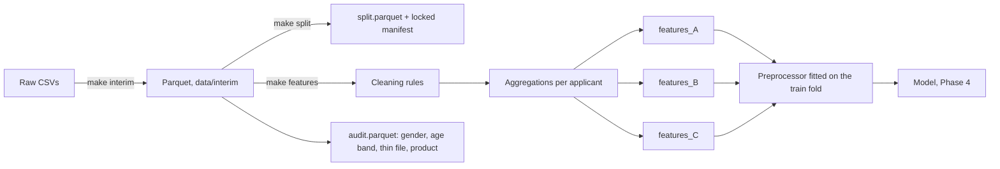

# Data pipeline and features (Phase 3)

*18 November 2026. Code: `src/credit_risk/data/` and `src/credit_risk/features/`. Rebuild: `make split features`.
Machine-readable record: `configs/split_manifest.json`, `configs/feature_manifest.json`.*

## Summary

The pipeline turns the eight raw tables into one row per applicant for each ablation stage (D25): **93 features for
stage A** (application form), **116 for B** (+ bureau) and **157 for C** (+ Home Credit history). It applies every
cleaning rule from the leakage table, reads only columns the leakage table allows, and runs in about 18 seconds
(peak memory 3.3 GB). The train / validation / test split is fixed and fingerprinted. 34 unit tests cover the
rules; none needs the Kaggle data.

## How it fits together

| Step | Module | Output |
| --- | --- | --- |
| Cleaning | `credit_risk.data.clean` | Applied inside each feature module; nothing fitted |
| Split | `credit_risk.data.split` | `data/processed/split.parquet`, `configs/split_manifest.json` |
| Features | `credit_risk.features.*` | `data/processed/features_{A,B,C}.parquet` |
| Audit table | `credit_risk.features.audit` | `data/processed/audit.parquet` (never a model input) |
| Preprocessing | `credit_risk.features.preprocess` | An unfitted scikit-learn transformer, fitted on the train fold inside the model pipeline |

## The split (D20, D42)

Stratified on `TARGET`, seed 42, rows sorted by applicant ID first so the split does not depend on file order.

| Fold | Applicants | Defaults | Default rate |
| --- | --- | --- | --- |
| train | 215,257 | 17,377 | 8.07% |
| valid | 46,127 | 3,724 | 8.07% |
| test | 46,127 | 3,724 | 8.07% |

Each fold's sorted IDs are fingerprinted (SHA-256) in `configs/split_manifest.json`. Rebuilding the split refuses
to overwrite a different result unless run with `--relock`, so the locked test set cannot change unnoticed.

## Cleaning rules applied

| Table | Rule |
| --- | --- |
| application | `DAYS_EMPLOYED = 365243` to missing plus flag `EMPLOYED_NA`; gender `XNA` to missing (audit only) |
| bureau | Drop the 17 rows updated after the application; dates below −40,000 days and end dates before the start to missing |
| bureau_balance | Months up to 0 (the application month); `--bb-max-month -1` builds the stricter ablation |
| previous_application | 365243 in five date columns and −1 in `SELLERPLACE_AREA` to missing; `AMT_CREDIT` only for approved applications; tiny negative down payments to 0 |
| installments | Split payments summed per instalment; lateness from the last payment; earliness capped at 365 days; unpaid instalments kept as missing payments |
| all amounts in bureau | Only "currency 1" (99.9% of rows) enters amount sums |

## Features by block

| Block | Stage | Features | Applicants with source rows | Examples |
| --- | --- | --- | --- | --- |
| application | A | 93 | 307,511 | 83 form columns, plus credit/income, annuity/income, credit/goods, term, income per person, mean and min of the external scores, document count, `EMPLOYED_NA` |
| bureau | B | 23 | 263,490 | credit counts (active, bad debt or sold, opened in last 7 / 90 days), current overdue, active debt and its ratio to credit, remaining term, worst days-past-due bucket ever and in the last 12 months, share of late months |
| previous | C | 17 | 291,057 | applications approved / refused / cancelled, refused share, days since last refusal, applications in last 30 days, asked vs granted, running loans and their annuity, reject reasons |
| installments | C | 8 | 291,643 | late share overall and in the last year, mean and max days late, unpaid count, under-paid share, paid ratio |
| pos | C | 6 | 289,444 | months, loans, worst days past due overall and in the last 12 months, remaining instalments on active loans |
| credit_card | C | 10 | 86,905 | utilisation mean and latest, drawings, worst days past due, share of months paid below the minimum, latest balance and limit |

From the main table, 35 columns allowed by the leakage table are left out on purpose: 7 near-constant flags
and 28 building-statistics duplicates (`_MEDI` correlates 0.99+ with `_AVG`, numeric `_MODE` 0.97+, with the same
missing pattern). When an applicant has no rows in a related table, counts and sums are 0 (no credits) while
ratios, means and maxima stay missing (D44).

## Guards against leakage and unfairness

- **Declared sources.** Every feature module lists the exact columns it reads, and the loader reads nothing else.
  `tests/test_feature_sources.py` checks each one against `configs/feature_availability.csv`: no label, no protected
  attribute, keys only for joining, and no column used before its ablation stage.
- **Protected attributes live in a separate audit table** with gender, age and age band, thin file and product. It feeds the fairness
  and slice reports in Phase 6 and is not part of any stage (tested).
- **Preprocessing is fitted on the training fold only** (D21): caps at the 0.1% and 99.9% quantiles, median imputation
  with missing flags, one-hot encoding with levels under 50 training rows grouped. Unseen levels at scoring time
  map to that group instead of failing.

## Checks on the real data (training fold only)

- No `TARGET`, `CODE_GENDER` or `DAYS_BIRTH` column in any feature table; the validation fold preprocesses to
  351 columns with no missing values.
- The EDA signals reappear from the new features: a currently overdue bureau credit 15.7% default (n = 2,295);
  more than half of earlier applications refused 16.4% (7,752); more than 20% of instalments late 11.9% (29,218).
- Of the 30 strongest single features by ROC-AUC, 16 come from the related tables, led by card utilisation (0.65),
  active bureau debt ratio (0.58) and late-instalment share in the last year (0.57). The strongest overall is still the
  mean external score (0.72). These are single-feature checks, not model results.
- `BUR_COUNT = 0` and the thin-file flag disagree for one applicant: their only bureau credit was among the 17 rows
  dropped for a post-application update. The thin-file flag follows D30 (a record existed), the feature follows
  the leakage rule, and both are right for their purpose.

## Limits

Aggregations are a first, hand-designed set; Phase 5 ablations will show which blocks pay for themselves. Peak
memory (3.3 GB) is close to a 4 GB machine; a larger feature set would need chunked or DuckDB aggregation.
